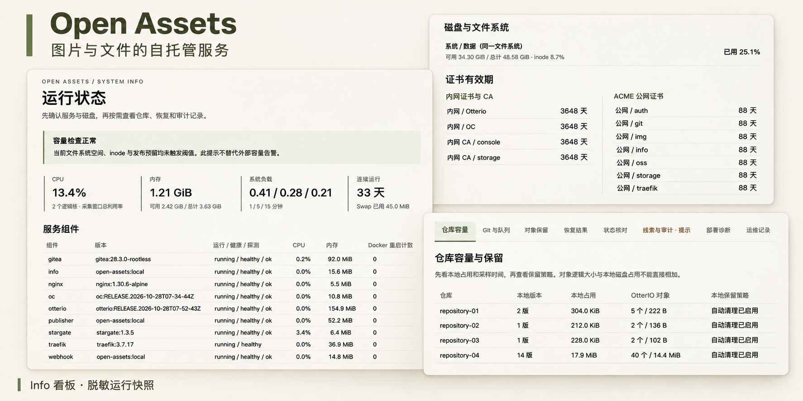

# Open Assets



图片与文件的自托管服务，让你在自己的服务器上管理和分享内容。

为网站、应用和项目提供图片与文件访问链接。通过网页上传、下载和管理存储对象，或通过 Git 自动发布图片与附件。管理入口统一认证，服务状态、证书和存储空间可以在看板中查看。

## 项目特点

- **网页管理与 Git 自动发布**：通过浏览器管理文件；需要版本记录和自动更新时，将内容提交到 Git，由程序完成导出、校验和发布。
- **两种链接，满足不同用途**：图片使用固定地址，随当前版本更新；附件地址包含提交版本，方便引用和追溯。历史附件在对应对象保留期间有效。
- **多个仓库，独立图片路径**：为不同项目配置仓库和访问前缀，统一命令协调只读 Deploy Key、Webhook、存储权限和图片映射，支持重复执行。
- **发布可查，历史内容可恢复**：查看任务状态和校验结果；从 Git 重建已清理的历史内容，完整校验后可显式回滚图片版本。
- **日常维护集中查看**：Info 展示组件健康、磁盘、证书与历史版本占用；doctor 提供诊断和下一步建议，保留策略帮助管理存储空间。

## 服务组成


各组件分别负责接收内容、发布文件、提供访问和日常管理：

- **Gitea**：托管内容仓库，接收 Git Push，并通知发布服务。
- **Webhook 与 Publisher**：验证来自 Gitea 的通知并排队处理，依次导出、校验和发布仓库中的文件。
- **OtterIO**：提供兼容 S3 的对象存储，保存版本附件和网页上传的文件。
- **OC**：存储管理网页，用于登录后上传、下载和管理 OtterIO 中的文件。
- **Nginx**：提供当前版本的图片访问，让图片保持固定链接。
- **Traefik**：统一提供 HTTPS 入口，将请求转发到对应服务，并提供入口管理页面。
- **Stargate**：为 Gitea、OC、Traefik 管理页和 Info 提供统一的登录保护；各应用自身的账号和权限仍然生效。
- **Info**：运行看板，展示组件健康、证书有效期、磁盘占用和发布维护状态。

公开图片和已配置公开权限的附件无需登录即可访问。应用容器不挂载 Docker socket；Info 的容量与诊断数据由定时任务采集，页面刷新不会触发存储遍历或 doctor 检查。日志轮转和受限健康恢复由宿主机定时任务管理。

## 选择适合的上传方式

**网页上传**适合直接管理存储对象。在 OC 存储管理后台上传、下载和管理文件，访问权限由存储策略决定。上传不会自动同步到 Git，也不会更新 Nginx 的图片目录；对外分享需先配置[网页公开目录](docs/web-uploads.md)，默认不自动公开所有上传内容。

**Git 发布**适合需要修改记录、版本链接和图片自动更新的内容。将文件放入仓库的 `public/` 并 Push 后，程序校验内容、上传版本附件，再更新当前图片目录。通过 SSH Push 时不需要先登录网页。

Git 发布后的链接示例：

```text
public/images/logo.png  → https://img-node-name.lab.dev/logo.png
public/documents/a.pdf  → https://oss-node-name.lab.dev/attachments/repositories/main-images/releases/<SHA>/documents/a.pdf
```

图片默认缓存 300 秒，更新后客户端可能暂时看到旧内容。历史附件默认保留；启用对象清理并实际删除后，旧链接会失效。示例域名和节点名需替换为自己的值。

Git 管理的版本目录应交由发布程序维护，避免在网页后台直接修改，造成对象与校验清单不一致。登录和访问链接的具体用法见[使用指南](docs/usage.md)。

## 开始使用

第一次部署，按下面三步完成安装和分享：

1. **准备环境**：查看[环境要求](docs/requirements.md)，确认服务器、域名、工具和存储空间。
2. **选择部署路线**：没有 Traefik 时，按[全新服务器指南](docs/new-server.md)安装；已有 Traefik 时，按[接入说明](docs/deployment.md)复用入口。两条路线选择一条即可。
3. **分享第一个文件**：按[首次分享指南](docs/first-share.md)完成网页上传或 Git 发布，再从无需登录的客户端下载文件并核对内容。

如果服务已由管理员部署，直接从[使用指南](docs/usage.md)查看登录、上传、Git 密钥和链接获取方法，无需重新安装。使用 Git 时，只有对应提交的任务显示 `published` 才表示发布完成；Push 成功不等于文件已可访问。

日常操作见[命令速查](docs/operator.md)，为其他项目接入仓库见[仓库 CLI](docs/cli.md)。管理员可按 [Info 说明](docs/info.md)配置运行看板；遇到问题时，按[故障排查](docs/troubleshooting.md)检查。其他配置与维护文档收录在[文档目录](docs/README.md)。

## 使用前确认

- **部署范围**：面向单机 Docker Compose、单个 Publisher 和本地 POSIX 文件系统。默认使用 `/app/open-assets`、`/data/asset-stack` 及约定的网络、端口；调整前先核对[部署配置](docs/configuration.md)。
- **Git 内容限制**：每个发布版本的 `public/images/` 至少包含一张图片，支持 PNG/JPEG/GIF/WebP/AVIF/ICO。SVG 不能放入图片目录；放在其他 `public/` 路径时可作为附件原样发布（不做 SVG 净化）。不支持 LFS、submodule、符号链接和隐藏路径，也不会执行仓库脚本。详见 [SVG 使用范围](docs/svg.md)。
- **配置与凭据**：初始化仅用于新部署；已有配置或初始化记录会阻止重复执行，先按[故障排查](docs/troubleshooting.md)核对状态。升级、改域名和新增仓库使用对应维护步骤。`.env`、`private/`、私钥与备份只保存在受保护的位置，不提交到 Git。
- **容量与备份**：Git/队列预算和流式校验不能替代磁盘配额、容器内存限制及备份。对象上传与图片切换没有联合事务，失败时可能留下部分对象；正式使用前安排备份，并按内容规模配置[资源预算](docs/resource-limits.md)和[保留策略](docs/object-retention.md)。

恢复操作见[恢复内容](docs/object-restore.md)，权限与已知限制见[安全说明](SECURITY.md)和[风险控制](docs/risks.md)。

项目采用 [Apache-2.0](LICENSE)。参与开发见[贡献指南](CONTRIBUTING.md)和[开发测试](docs/development.md)，已验证范围见[验证记录](docs/acceptance.md)。
