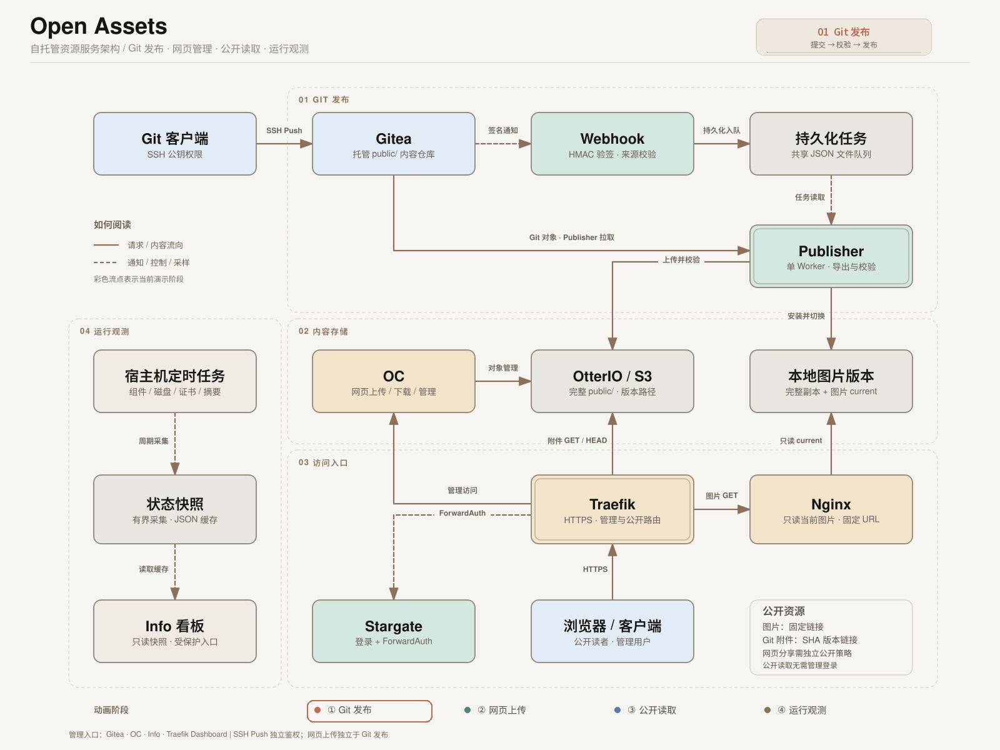

# Open Assets

Open Assets 将 Gitea 仓库中的文件发布到 OtterIO 和 Nginx。开发者通过 SSH Push 更新内容；发布程序导出指定提交的 `public/`，把附件保存到带 commit SHA 的对象路径，再切换图片服务的当前版本。

项目适用于自己维护图片、文档和下载文件的单机环境。它包含发布程序、仓库接入 CLI、Docker Compose 配置，以及接入现有 Traefik 的脚本。许可证为 [Apache-2.0](LICENSE)。

Info 看板通过 Stargate 查看组件健康、CPU/内存、磁盘、证书到期时间和最近压测结果。容器带健康检查；宿主机可以按冷却时间与次数上限重启持续不健康的服务。网页容器只读快照，不持有 Docker 管理权限。

## 发布后的地址

假设仓库 key 为 `main-images`，图片前缀为 `/`，提交包含：

```text
public/
├── images/2026/11/07/logo.png
└── documents/manual.pdf
```

图片通过固定地址访问：

```text
https://img-node-name.lab.dev/2026/11/07/logo.png
```

附件通过版本地址访问：

```text
https://oss-node-name.lab.dev/attachments/repositories/main-images/releases/<完整SHA>/documents/manual.pdf
```

图片地址在下一次成功发布后指向新版本，默认缓存 300 秒。附件地址包含完整 SHA，适合在文章或版本说明中引用；默认不自动删除历史附件，显式启用[对象保留策略](docs/object-retention.md)并执行清理后，过期附件链接会失效。文档中的 `lab.dev` 是占位域名，不能原样用于生产配置。

## 阅读顺序

- 已经部署：从 [实际使用指南](docs/usage.md) 开始，查看登录凭据、设置个人 SSH 密钥、克隆仓库并 Push。
- 首次部署：先读 [部署说明](docs/deployment.md)，确认固定路径、网络、证书和初始化脚本的适用范围。
- 接入其他仓库：使用 [仓库接入 CLI](docs/cli.md)。命令协调 Gitea、S3 权限和 Nginx 映射，不会替你提交内容。
- 调整配置：参考 [配置说明](docs/configuration.md) 和 [仓库与 URL 配置](docs/repositories.md)。
- 处理失败、回滚或备份：参考 [运行维护](docs/operations.md) 和 [故障排查](docs/troubleshooting.md)。
- 查看监控与恢复策略：参考 [Info 看板](docs/info.md) 和 [健康检查与受限恢复](docs/health.md)。
- 更新组件、替换十年内部证书或复现采样：参考 [升级说明](docs/upgrade.md) 和 [性能与缓存分析](docs/performance.md)。
- 理解程序行为和验证范围：参考 [发布流程](docs/architecture.md)、[验收记录](docs/acceptance.md) 与 [安全说明](SECURITY.md)。

## 日常操作

以下命令在已经完成初始化的服务器执行：

```sh
cd /app/open-assets
sudo ./scripts/open-assets repo ensure content/project-b \
  --key project-b \
  --mount-path /project-b/
```

返回 `status: ready` 后，开发者使用个人 Gitea SSH 密钥克隆仓库，把图片放进 `public/images/`，把其他附件放进 `public/` 下的相应目录，然后提交到配置分支。接入命令创建的是空私有仓库；Publisher 的只读 Deploy Key 不用于开发者 Push。

查看发布结果：

```sh
cd /app/open-assets
sudo docker compose exec -T publisher python -m open_assets status
```

只有目标仓库与 SHA 对应的任务显示 `published`，才表示该次发布完成。`git push` 成功和 Webhook 返回 202 都不是发布成功的标志。

## 服务组成



架构图按三类链路展示服务；同名服务在不同视图中重复出现，仍是同一部署实例。动画依次演示发布、图片读取、附件读取和管理认证，只表示调用或操作方向，不表示实际延迟、并发或事务边界。域名均为示例。

- **自动发布**：Gitea 向内部 Webhook 接收器发送签名事件。接收器校验签名、仓库和分支，将任务持久化后返回 202。单个 Publisher 串行处理任务，从固定 remote 拉取提交并导出 `public/`，上传、校验 OtterIO 对象，再原子切换对应仓库的图片 `current`。接收器和 Publisher 使用同一个应用镜像，以不同命令和挂载权限运行。
- **公开读取**：现有 Traefik 提供 HTTPS 和路由。图片请求由 Nginx 从只读挂载的当前图片目录提供；附件请求经 OtterIO S3 读取带 SHA 的版本对象。两个入口均允许匿名 GET/HEAD，不经过 Stargate。普通图片发布不需要重载 Nginx；新增仓库映射时才生成、校验并重载配置。
- **管理访问**：Traefik 通过 Stargate ForwardAuth 校验会话，通过后才将业务请求转发给 Gitea、OC Console、Dashboard/API 或 Info。Stargate 不代理这些应用的业务流量；Gitea 和 OC 保留各自的应用认证。OC 通过内网 HTTPS 访问 OtterIO S3 和 Admin API，`9001` 是 Admin API，管理网页由独立 OC Console 提供。Git SSH 使用 Gitea 密钥，不经过 HTTP 认证层。

宿主机仓库接入 CLI 使用本机 Docker 和私有管理员配置。应用容器不挂载 Docker socket，也不获得这项管理权限。

宿主机另有两个独立定时任务：采集器写入过滤后的状态快照；恢复程序只处理明确项目/服务范围内的持续 unhealthy 容器。重启不是数据修复，维护时应设置标记，持续故障仍需人工处理。内部证书使用 Certs Maker 3.8.2，叶证书与 CA 均为 3650 天；公网证书继续由原 Traefik 的 ACME 管理。

图中仓库接入命令 `repo ensure` 负责协调仓库、只读 Deploy Key、Webhook、S3 权限和 Nginx 映射，支持重复执行。具体参数见 [仓库接入 CLI](docs/cli.md)；发布状态、故障恢复和跨系统操作的限制见 [发布流程](docs/architecture.md)。

架构图使用 [fireworks-tech-graph](https://github.com/yizhiyanhua-ai/fireworks-tech-graph/) 的 Claude 风格生成，并在 SVG 上定制流向动画。

## 使用限制

节点名由 `NODE_NAME` 指定，默认 `node-name`，初始化后记录在私有 `.env` 中；示例地址中的 `node-name` 应替换为自己的节点名。修改已有部署的节点名需要另行迁移域名、证书和认证配置，不能只修改 `.env`。操作范围见 [节点与域名配置](docs/configuration.md#节点与域名)。

当前配方固定使用 Compose 项目名 `asset-stack`、`/app/open-assets` 和 `/data/asset-stack`。适用范围是单机 Docker Compose、一个 Publisher 和本地 POSIX 文件系统；改变路径、项目名或拓扑前需要检查脚本中的固定值。`NODE_NAME` 不会隔离同一主机上的端口、网络或数据目录。

发布程序不执行内容仓库脚本，不支持 LFS、submodule、符号链接或隐藏路径。图片按扩展名限制为 PNG/JPEG/GIF/WebP/AVIF/ICO，不检测文件格式或恶意内容。每个版本需包含 `public/images/` 中至少一张图片；其余文件作为附件发布。

失败任务不会自动重试。程序重启会重新处理遗留的 `running` / `images_prepared` 任务，但自动任务若已不是远端分支头，会被标记为 `superseded`。对象上传、图片切换和任务记录之间没有跨系统事务；部分对象可能在任务完成前已能读取。

回滚副本校验和异常任务隔离已完成；容量管理、默认管理权限及跨系统一致性仍有边界，具体状态与建议见 [风险评估](docs/risks.md)。

## 本地检查

发布程序使用 Python 3.13 和 Git；宿主机初始化另需 PyYAML、bcrypt、OpenSSL、OpenSSH 及 Docker Compose。详细依赖和启动顺序见部署文档。

```sh
python3 -m venv .venv
. .venv/bin/activate
pip install -r requirements.txt
python -m unittest discover -s tests -v
```

普通测试使用临时目录和回环 HTTP 端口，不连接生产服务器。独立的 [从零部署脚本](tests/e2e/README.md) 仅用于可丢弃的空环境；执行结果见 [隔离部署记录](docs/fresh-install.md)。仓库中的 [CI](.github/workflows/test.yml) 另外运行 Ruff 和镜像构建。一次部署的成功记录不代表所有浏览器、硬件或升级路径均已验证。

日志保存与磁盘占用控制见 [日志管理](docs/logging.md)。

本地历史版本的数量/时间保留、固定回滚点和终态任务归档见 [历史清理](docs/retention.md)；默认只预览，OSS 历史附件继续保留。

Info 看板提供各仓库本地版本数、占用、保留策略和最近完整清理结果，并提示空间、inode 及发布预留不足。采样范围和阈值配置见 [Info 说明](docs/info.md)。

Info 同时展示仓库的本地容量和 OtterIO 对象数量、逻辑大小。对象统计独立定时采集、分页限速并缓存，页面刷新不会遍历存储；安装与统计边界见 [Info 文档](docs/info.md#otterio-对象统计)。

历史容量管理分为[本地版本保留](docs/retention.md)和[OtterIO 对象保留](docs/object-retention.md)。对象清理默认只预览，使用独立账号，保护当前版本、回滚点、固定版本与在途任务引用。

Info 的对象保留区域区分最近完整预览、完整执行和最近尝试，展示规划时的候选数量/容量及失败、跳过原因。页面读取缓存摘要，不触发 S3 遍历；字段含义见[Info 文档](docs/info.md#对象保留策略与清理记录)。

已清理的对象可用 restore-objects 从 Git 和原始清单恢复，不受已完成任务去重影响，也不切换当前图片入口。完整校验、重试和操作边界见[对象恢复](docs/object-restore.md)。

restore-objects 追加 --with-local 可从 Git 重建已清理的 public 和图片副本；默认保持当前入口。追加 --rollback 才在对象与本地副本全部校验后显式切换，见[本地恢复与回滚](docs/object-restore.md#重建本地-public--图片副本)。
